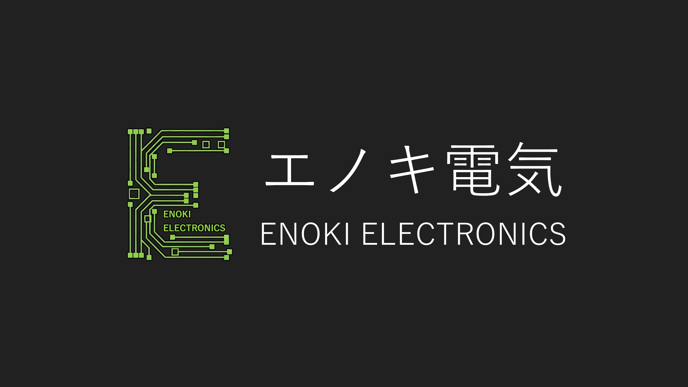

# 🍄 エノキ電気（ときえのき）の GitHub へようこそ

  

  🎵 <strong>音楽クリエイター（ボカロP）</strong> &nbsp;×&nbsp; 💻 <strong>個人開発者 / CTO</strong> &nbsp;×&nbsp; 🏍️ <strong>モビリティ・弱電愛好家</strong> 
  <em>「食えるもんは全部食う精神」</em> 
  <em>「『今年は法人化します』とかれこれ5年以上言い続けている」</em>

  
  
  
  
  
  

---

## 👤 自己紹介

2003年埼玉県さいたま市生まれ。屋号**「エノキ電気」**代表。
**某企業にてCTO（最高技術責任者）**を務める傍ら、**ボカロP（ときえのき / 刻夏P）**としての音楽活動、個人開発者としてのWebサービス・スマホアプリ・自作Linux OS開発、さらには弱電工作やバイクの自力エンジン載せ替えまで、多岐にわたる創作・開発を行っています。

「趣味で突き詰めていたら仕事になっていた」タイプ。気になるものはソフトウェアからハードウェア、インフラ、モビリティまで何でも自分で作って動かすマルチクリエイターです。

---

## 🎵 音楽活動

**ボカロP「ときえのき（刻夏P）」**として2017年よりVOCALOID楽曲の制作を開始。
作詞・作曲・編曲からCD制作、サブスク配信まで幅広く手掛けています。

|                                              🎸 音楽チャンネル                                              |                                      ⚡ 電気チャンネル（技術・工作系）                                      |
| :---------------------------------------------------------------------------------------------------------: | :---------------------------------------------------------------------------------------------------------: |
|  |  |

- 🎹 **サブスク配信**: Spotify、Apple Music、LINE MUSIC等でオリジナル楽曲を全世界配信
- 🎤 **カラオケ配信**: 全国の**JOYSOUND**設置店舗にてオリジナル楽曲がカラオケ歌唱可能
- 💿 **同人即売会**: コミックマーケット（C105）サークル参加にてオリジナルCDを頒布
- 🎮 **ゲームMOD**: Steam Workshop版『Cities: Skylines』向けに楽曲MOD [CS_Music](https://github.com/jikantoki/CS_Music) を提供
- 🕹️ **自作音ゲー**: 音ゲーアプリも自作 → [livehouse](https://github.com/jikantoki/livehouse)

---

## 🛠️ 使用技術・スキル

### Webフロントエンド / アプリ

  
  
  
  
  
  
  
  

### バックエンド / サーバー / インフラ

  
  
  
  
  
  
  
  

### システム・ハードウェア・組込み・その他

  
  
  
  
  
  
  
  
  

---

## 🖥️ プロジェクト一覧

### 🤖 AI・自動化・メディア

| プロジェクト                                                                   | 説明                                                     | 言語 / 技術                 |
| :----------------------------------------------------------------------------- | :------------------------------------------------------- | :-------------------------- |
| 📻 [gemini-voicevox-radio](https://github.com/jikantoki/gemini-voicevox-radio) | AIによるラジオ番組制作を全自動で実行するAll-In-Oneキット | PHP / Gemini API / VOICEVOX |
| 🎙️ [neruru-radio-homepage](https://github.com/jikantoki/neruru-radio-homepage) | ラジオ番組関連ホームページ                               | HTML                        |

### 🌐 Webサービス・Webアプリ

| プロジェクト                                                                                     | 説明                                                                | 言語 / 技術                   |
| :----------------------------------------------------------------------------------------------- | :------------------------------------------------------------------ | :---------------------------- |
| 🏠 [jikantoki-appcenter](https://github.com/jikantoki/jikantoki-appcenter)                       | ENOKI Appcenter ― エノキ電気公式ホームページ・Webストア兼プレイヤー | Nuxt 4 / TypeScript / Vuetify |
| 💬 [Markdown_SNS](https://github.com/jikantoki/Markdown_SNS)                                     | マークダウンでシンプルに投稿できる自作SNS（⭐ 10+）                 | PHP / MySQL                   |
| 🗺️ [map-studio](https://github.com/jikantoki/map-studio)                                         | 地図上に架空の路線図などを自由に描けるWebアプリ                     | Vue.js                        |
| 📋 [tasc](https://github.com/jikantoki/tasc) / [ws](https://github.com/jikantoki/tasc-websocket) | リアルタイム同期対応の簡潔なタスク管理ツール                        | Vue.js / Node.js WebSocket    |
| 💰 [keiban](https://github.com/jikantoki/keiban)                                                 | 個人事業主向け報酬・経理管理アプリ                                  | Vue.js                        |
| 💰 [uber_utility](https://github.com/jikantoki/uber_utility)                                     | 個人事業主・配達員向けユーティリティツール                          | Vue.js                        |
| 🎵 [wave](https://github.com/jikantoki/wave)                                                     | 音楽共有機能付きSNS                                                 | Vue.js                        |
| ▶️ [youtube-downloader](https://github.com/jikantoki/youtube-downloader)                         | YouTube動画をダウンロードできるWebサイト                            | HTML / JavaScript             |
| 🛒 [OpenEC](https://github.com/jikantoki/OpenEC)                                                 | 誰でもECサイトが作れる軽量オープンソースフレームワーク              | -                             |
| 🔗 [jumpserver](https://github.com/jikantoki/jumpserver)                                         | 別サーバー情報中継 / ポートフォワーディングツール                   | PHP                           |
| 📢 [enoki-adsense](https://github.com/jikantoki/enoki-adsense)                                   | エノキ電気サービス向け自前広告管理システム                          | TypeScript                    |

### 📱 スマホアプリ（Android / Cross-Platform）

| プロジェクト                                                                 | 説明                                                    | 言語 / 技術        |
| :--------------------------------------------------------------------------- | :------------------------------------------------------ | :----------------- |
| 🎵 [dopamine](https://github.com/jikantoki/dopamine)                         | 洗練されたUIのモダンAndroid音楽プレイヤーアプリ         | Vue.js / Capacitor |
| 🗺️ [Nomad-Pulse](https://github.com/jikantoki/Nomad-Pulse)                   | 位置情報記録・リアルタイム共有アプリ                    | Vue.js / Capacitor |
| 💳 [wallet-wallet](https://github.com/jikantoki/wallet-wallet)               | クレジットカード情報等を安全に手元で管理するアプリ      | Vue.js / Capacitor |
| 🎶 [jikantokiMusicPlayer](https://github.com/jikantoki/jikantokiMusicPlayer) | ときえのきの楽曲がいつでも聴ける専用プレイヤー          | Vue.js             |
| 🎬 [VueTube](https://github.com/jikantoki/VueTube)                           | 動画ストリーミングプレイヤーアプリ                      | Vue.js / Capacitor |
| 🎮 [livehouse](https://github.com/jikantoki/livehouse)                       | 音楽ゲーム（音ゲー）アプリ                              | Vue.js / Capacitor |
| 📰 [wordpress-viewer](https://github.com/jikantoki/wordpress-viewer)         | WordPressブログをニュースアプリ感覚で閲覧できるリーダー | Vue.js / Capacitor |

### 📦 開発テンプレート・スターターキット

| プロジェクト                                                                         | 説明                                              | 言語 / 技術            |
| :----------------------------------------------------------------------------------- | :------------------------------------------------ | :--------------------- |
| ⚡ [nuxt4temp](https://github.com/jikantoki/nuxt4temp)                               | 最先端 Nuxt 4 開発スターターテンプレート          | Nuxt 4 / Vue.js        |
| ⚡ [nuxt3temp](https://github.com/jikantoki/nuxt3temp)                               | Nuxt 3 開発テンプレート                           | Nuxt 3 / Vue.js        |
| 🎨 [vuetifyTemplate](https://github.com/jikantoki/vuetifyTemplate)                   | Vue 3 + Vuetify 簡単スターターテンプレート        | Vue.js / Vuetify       |
| 📱 [capacitor-template](https://github.com/jikantoki/capacitor-template)             | Vue.jsでAndroidアプリを作るCapacitorテンプレート  | TypeScript / Capacitor |
| 📱 [capacitor-template-nuxt](https://github.com/jikantoki/capacitor-template-nuxt)   | Nuxtでネイティブアプリ化するCapacitorテンプレート | TypeScript / Nuxt      |
| 📱 [Vue-Android-APK-Template](https://github.com/jikantoki/Vue-Android-APK-Template) | Vue.jsからAndroid APKをビルドするテンプレート     | Vue.js / Capacitor     |

### 🐧 Linux / 自作OS / ブラウザ

| プロジェクト                                                       | 説明                                                                     | 言語 / 技術        |
| :----------------------------------------------------------------- | :----------------------------------------------------------------------- | :----------------- |
| 🍬 [Caramel OS](https://caramelos.xyz)                             | 自作Linuxディストリビューション（**Xubuntu公式HPに公式派生として掲載**） | Shell / Ubuntu派生 |
| 🍬 [Upper Linux](https://caramelos.xyz/other/upper/)               | 自作Linuxディストリビューション作成用ベースイメージ                      | Shell              |
| 🚀 [CaramelLauncher](https://github.com/jikantoki/CaramelLauncher) | Caramel OS向けアプリケーションランチャー                                 | Shell              |
| 🌐 [Flast](https://github.com/jikantoki/Flast)                     | ChromiumベースのクロスプラットフォームWebブラウザ                        | C++ / Chromium     |

### 🍓 ハードウェア・Raspberry Pi・組込み・弱電

| プロジェクト                                                               | 説明                                                                              | 言語 / 技術       |
| :------------------------------------------------------------------------- | :-------------------------------------------------------------------------------- | :---------------- |
| 🚃 [jr_hassha](https://github.com/jikantoki/jr_hassha)                     | Raspberry PiのGPIO制御でJR発車メロディーを再生                                    | Bash / GPIO       |
| 🎧 [raspberry-car-audio](https://github.com/jikantoki/raspberry-car-audio) | Raspberry Piを活用した自作車載カーオーディオ                                      | PHP / Linux       |
| 💡 [LEDNEWS](https://github.com/jikantoki/LEDNEWS)                         | 自作LED電光掲示板に最新ニュースや広告を流すスクリプト（Red Bull公式宣伝等に使用） | HTML / JavaScript |

### 💻 デスクトップアプリ（Windows GUI / CUI）・ゲーム

| プロジェクト                                                             | 説明                                                    | 言語 / 技術       |
| :----------------------------------------------------------------------- | :------------------------------------------------------ | :---------------- |
| 🍄 [super3](https://github.com/jikantoki/super3)                         | スーパーマリオ風アクションゲーム（高校卒業制作 / ⭐ 6） | AngelScript / HSP |
| 🎰 [yukkuri-monogatari](https://github.com/jikantoki/yukkuri-monogatari) | パチンコ風Windowsゲーム                                 | AngelScript / HSP |
| 🎰 [pachi_simulator](https://github.com/jikantoki/pachi_simulator)       | 日本式パチンコシミュレーション                          | C                 |
| 🕐 [timegadget](https://github.com/jikantoki/timegadget)                 | Windows用デスクトップ時計ガジェット                     | C++               |
| 📝 [easynote](https://github.com/jikantoki/easynote)                     | 超シンプルな軽量メモ帳                                  | HSP               |
| 🔧 [E-compiler](https://github.com/jikantoki/E-compiler)                 | 独自設計言語「E言語」のコンパイラ                       | C                 |
| 📁 [nichiji_koushin](https://github.com/jikantoki/nichiji_koushin)       | ファイルの更新日時・アクセス時刻を現在時刻に一括変更    | Bash              |
| 📝 [CUInote](https://github.com/jikantoki/CUInote)                       | 高校の授業で作成したCUIメモ帳                           | C                 |
| 🔢 [Matrix-walking](https://github.com/jikantoki/Matrix-walking)         | 行列探索アルゴリズム課題の改変                          | C                 |

### 🧩 ブラウザ拡張・MOD・その他

| プロジェクト                                                         | 説明                                                               | 言語 / 技術 |
| :------------------------------------------------------------------- | :----------------------------------------------------------------- | :---------- |
| 🚫 [Twitter_No_Spam](https://github.com/jikantoki/Twitter_No_Spam)   | Twitter（X）のインプレゾンビ・スパムを排除するChrome拡張機能       | JavaScript  |
| 🎵 [CS_Music](https://github.com/jikantoki/CS_Music)                 | 『Cities: Skylines』ゲーム内で自分の楽曲を再生できるMOD            | C#          |
| 🧪 [virus_experience](https://github.com/jikantoki/virus_experience) | ジョークウイルス体験プログラム                                     | -           |
| 🌿 [css_muda](https://github.com/jikantoki/css_muda)                 | 「限りある資源CSSを無駄遣いし、SDGsに反抗しよう。」ユニークWeb作品 | HTML / CSS  |

---

## 🌐 Websites & Services

| サービス                                     | URL                                                                                       | 説明                                                                 |
| :------------------------------------------- | :---------------------------------------------------------------------------------------- | :------------------------------------------------------------------- |
| 🏠 **エノキ電気 公式ホームページ**           | <https://enoki.xyz>                                                                       | ENOKI Appcenter ― ポートフォリオ・経歴・アプリ配布ストア兼プレイヤー |
| 📝 **エノキ電気ニュース / エレクトロライフ** | <https://blog.caramelos.xyz>                                                              | 自作PC・電子工作・Linux・バイクなどの実践ノウハウブログ              |
| 🍬 **Caramel OS**                            | <https://caramelos.xyz>                                                                   | 自作Linuxディストリビューション公式サイト（Xubuntu公式掲載）         |
| 🎵 **Android 音楽プレイヤー**                | <https://dopamine.enoki.xyz>                                                              | Web版 dopamine プレイヤー                                            |
| 💬 **自作 SNS**                              | <https://ec.enoki.xyz>                                                                    | Markdown_SNS 本番稼働環境                                            |
| 💰 **個人事業主向け報酬管理**                | <https://uber.enoki.xyz>                                                                  | 個人事業主・フリーランス向け収支管理Webサービス                      |
| 📱 **Google Play Store**                     | [デベロッパーページ](https://play.google.com/store/apps/dev?id=8940000495375956936&hl=ja) | Androidネイティブアプリ配信                                          |

---

## 📊 GitHub Stats

  
  

---

## 📜 経歴・歩み

| 年 / 月       | 出来事                                                                                                                          | 分野        |
| :------------ | :------------------------------------------------------------------------------------------------------------------------------ | :---------- |
| **2003 / 01** | 埼玉県さいたま市に爆誕 👶                                                                                                       | 誕生        |
| **2015 頃**   | プログラミング入門（Aviutl / C / Bash / VBScript）                                                                              | IT          |
| **2017**      | • HSP学習 • Android ROMカスタム（TWRP導入・FRP解除） • **ボカロP「ときえのき」として活動開始** 🎵                         | 音楽 / IT   |
| **2018 / 02** | YouTubeチャンネル開設、中学3年生で動画投稿開始 🎥                                                                               | メディア    |
| **2019 / 03** | まともに曲と呼べる初のオリジナルVOCALOID楽曲を公開 🎶                                                                           | 音楽        |
| **2020 / 03** | • 自作Linux「**[Caramel OS](https://caramelos.xyz)**」公開 🐧 • 技術ブログ「**エレクトロライフ**（blog.caramelos.xyz）」開設 | OSS / Web   |
| **2020 / 04** | 学生プログラマ団体「Fascode Network」と技術提携 🤝                                                                              | 提携        |
| **2020 / 05** | Spotify、Apple Music、LINE MUSIC等で楽曲サブスク配信開始 🎧                                                                     | 音楽        |
| **2020 / 06** | **ITパスポート（国家資格）** 取得 🎓                                                                                            | 資格        |
| **2020 / 08** | **Xubuntu公式HPにて自作「Caramel OS」が公式派生として紹介！** 🎉                                                                | OSS         |
| **2021 / 03** | 高校を卒業、日本工学院専門学校へ進学 🏫                                                                                         | 学歴        |
| **2021 / 04** | **JOYSOUNDにてカラオケ音源全国配信開始** 🎤                                                                                     | 音楽        |
| **2021 / 07** | Steam Workshop『Cities: Skylines』にて楽曲配信 🎮                                                                               | ゲーム      |
| **2021 / 08** | **基本情報技術者（午前免除）** 取得 / 自主制作CD販売開始 💿                                                                     | 資格 / 音楽 |
| **2021 / 09** | **開業届提出・青色申告承認、個人事業主「ときえのき」として独立** 📝                                                             | ビジネス    |
| **2021 / 10** | LINEスタンプ「意識が高くて低いスタンプ」販売開始 / アルバイト退職しフリー一本へ                                                 | ビジネス    |
| **2022 / 05** | 屋号を「エノキ電気グループ」へ名義変更 🏢                                                                                       | ビジネス    |
| **2022 / 06** | 原付免許取得 🛵 / ホンダ ディオ納車                                                                                             | モビリティ  |
| **2022 / 11** | 普通自動二輪免許取得 🏍️ / スズキ ジクサー150納車                                                                                | モビリティ  |
| **2022 / 12** | 位置情報SNS「Naunau」公式アンバサダー就任 ⭐                                                                                    | 実績        |
| **2023 / 01** | 「エノキ電気」名義で新屋号取得 ⚡ / 20歳 成人 🎂                                                                                | ビジネス    |
| **2023 / 02** | ジクサー150のエンジン故障に伴い、**自力でエンジン載せ替えを完遂** 🔧                                                            | モビリティ  |
| **2023 / 03** | 自作屋外電光掲示板にて **Red Bull パープルエディション** を宣伝 📢                                                              | 制作 / 広告 |
| **2023 / 08** | ベンチャーIT企業に在籍、Web開発現場で実践経験を積む 💼                                                                          | キャリア    |
| **2024 / 03** | 日本工学院専門学校卒業 🎓                                                                                                       | 学歴        |
| **2024 / 05** | 第一種普通自動車免許取得 🚗 / スズキ セルボ納車                                                                                 | モビリティ  |
| **2024 / 08** | 某企業に業務委託として参画（個人事業主も継続） 🚀                                                                               | キャリア    |
| **2024 / 12** | コミックマーケット（C105）にサークル参加、オリジナルCD頒布 💿                                                                   | 音楽        |
| **2025 / 07** | カワサキ Ninja250R 納車 🏍️💨                                                                                                    | モビリティ  |
| **2025 / 09** | 東京都内にてシェアハウス居住開始 🏠                                                                                             | ライフ      |
| **2026 / 01** | **某企業にて CTO（最高技術責任者）に就任** 👔✨                                                                                 | キャリア    |
| **2026 / 03** | スズキ パレットSW 納車 🚐                                                                                                       | モビリティ  |

---

  Made with ❤️ by <a href="https://enoki.xyz">エノキ電気 (jikantoki)</a>

